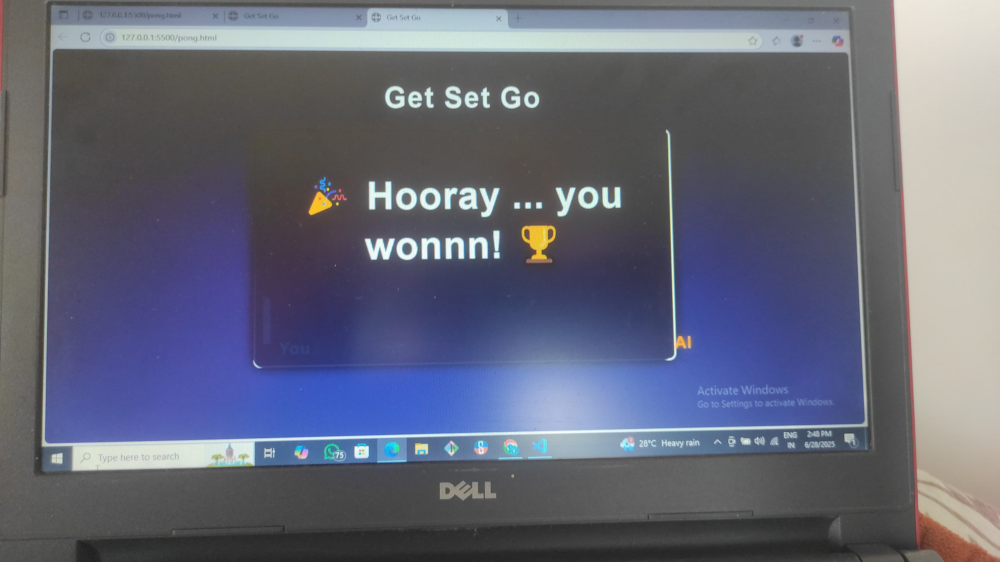

# Responsive Pong Game

Hello, all! This is a ping pong game I made when I was bored—my AI copilot suggested it and I gave it a try.  
A simple, responsive Pong game built with HTML, CSS, and JavaScript.

- Playable on desktop and mobile  
- Fun AI opponent  
- First to 5 wins

## Screenshots

## Demo

<!-- Or for a video recording: -->
<!-- <video src="assets/demo.mp4" controls width="700"></video> -->

## Play

Open `pong.html` in your browser.